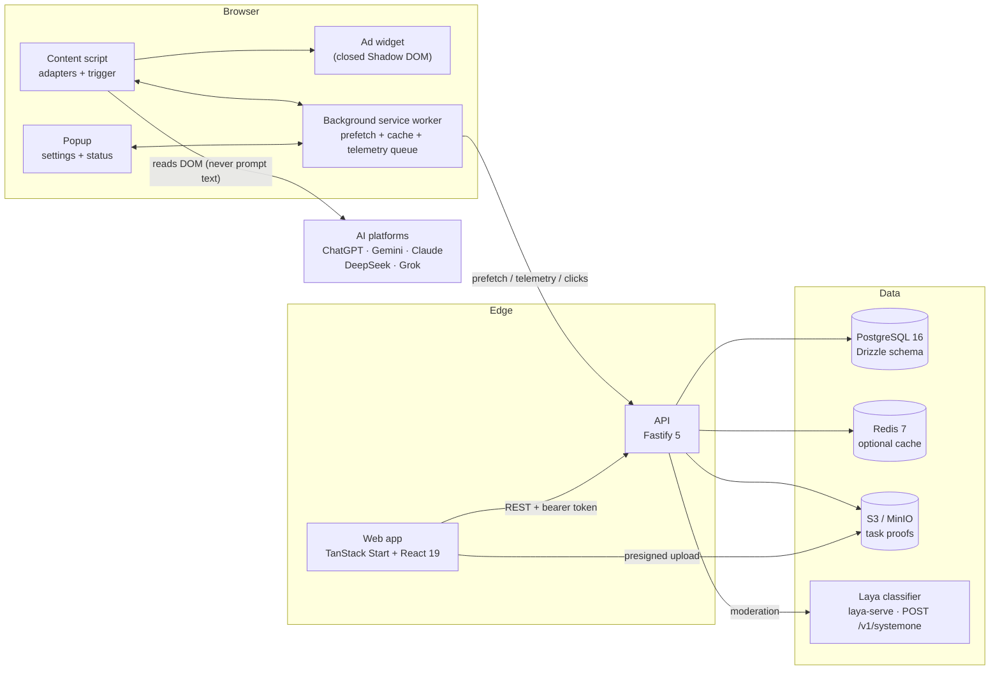
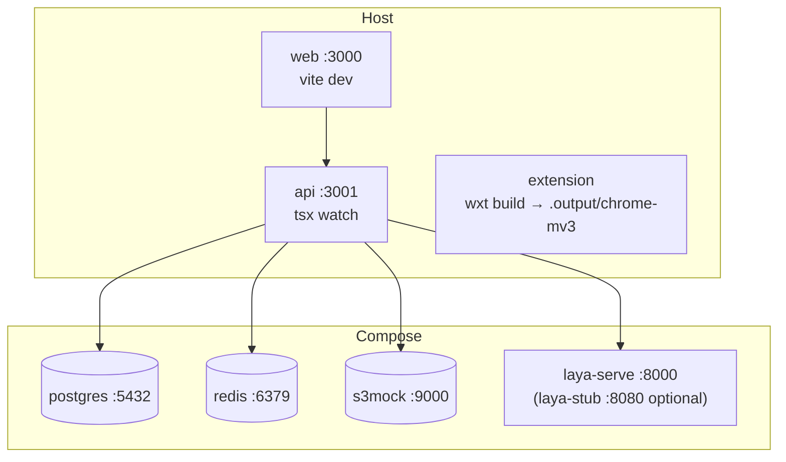
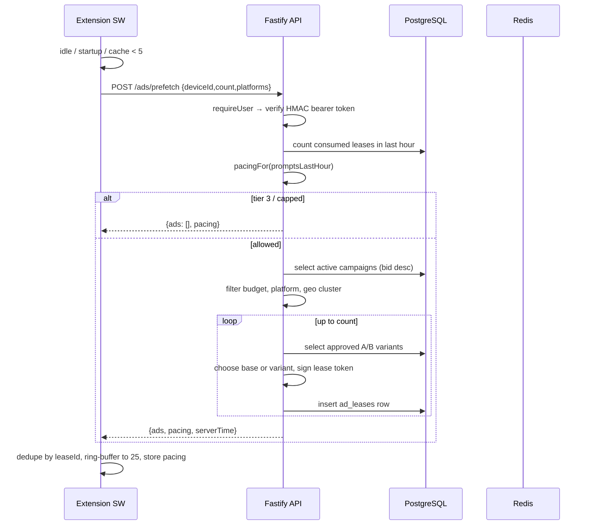
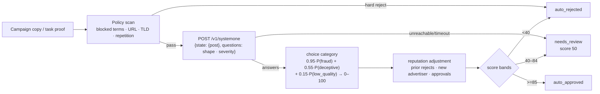
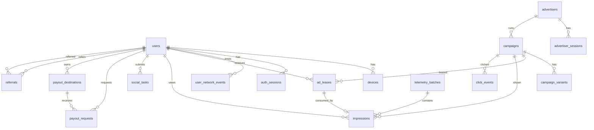

# MeanTime — Technical Architecture

**Status:** Implemented (v0.1), with documented gaps  
**Last updated:** 2026-11-03  
**Related docs:** [PRD.md](./PRD.md) · [DESIGN-SYSTEM.md](./DESIGN-SYSTEM.md) · [AGENTS.md](./AGENTS.md) · [TASKS.md](./TASKS.md)

---

## 1. System overview

MeanTime is a pnpm + Turborepo monorepo with four deployable workspaces and one
shared package.



### Key architectural properties

- **No server-rendered secrets.** The extension holds only a scoped bearer
  token and its own local settings.
- **Server-authoritative money.** The client reports view time; the server
  decides eligibility, revenue share, and ledger postings.
- **Single-use ad leases.** Every ad impression requires an HMAC-signed lease
  that the server consumes exactly once.
- **Privacy boundary at the API edge.** IP → coarse geo cluster in memory; raw
  IP is never persisted or returned.
- **Fail-safe moderation.** Policy checks run first; an unavailable classifier
  routes to human review, never auto-approval.
- **Bounded client storage.** The extension cache and telemetry queue have hard
  caps and survive service-worker suspension.

---

## 2. Monorepo layout

| Path | Package | Responsibility |
|---|---|---|
| `packages/shared` | `@meantime/shared` | TypeScript contracts, zod validators, WebCrypto lease helpers, Drizzle PostgreSQL schema, platform selector configs, constants. |
| `apps/api` | `@meantime/api` | Fastify API, auth, prefetch/lease issuance, telemetry ingestion, ledger, payouts, referrals, moderation, fraud engine, S3 presigning. |
| `apps/web` | `@meantime/web` | TanStack Start/React app: landing, dashboard, tasks, referrals, payouts, advertiser portal. |
| `apps/extension` | `@meantime/extension` | WXT Manifest V3 extension: background worker, content script, popup, adapters, widget, timers, local storage. |
| `infra/laya-stub` | (dev only) | Dependency-free Node test double that speaks Laya's `/v1/systemone` protocol for offline development. Not a model. |
| root | — | Turbo pipeline, pnpm workspace, Drizzle config, Docker compose, docs. |

### Workspace dependency graph

```
@meantime/web ─┐
@meantime/api ─┼──> @meantime/shared
@meantime/extension ─┘
```

`@meantime/shared` is built to `dist/` and its `exports` map points at the
compiled output. This is required for production Node execution and for
`pnpm start`; the Turbo `build` and `dev` tasks depend on `^build`.

---

## 3. Technology stack

| Layer | Technology | Why |
|---|---|---|
| Language | TypeScript 5.x (strict, `noUncheckedIndexedAccess`) | Shared types across browser and server. |
| Monorepo | pnpm 9 + Turborepo 2 | Fast installs, cached task graph, workspace linking. |
| Extension | WXT 0.19, Manifest V3, `@types/chrome` | Modern MV3 build, HMR, typed `defineBackground`/`defineContentScript`. |
| Extension UI | Vanilla DOM + closed Shadow DOM | Tiny bundle, style isolation from host pages, no framework runtime in content scripts. |
| API | Fastify 5, `@fastify/cors`, `@fastify/compress` | Low overhead, schema-free routes, built-in structured logging. |
| Validation | zod 3 | Runtime validation at HTTP boundaries, shared with types. |
| ORM | Drizzle ORM 0.38 + `node-postgres` | Typed SQL, explicit schema, migration generation. |
| Database | PostgreSQL 16 | Relational integrity, transactions, JSONB, aggregate queries. |
| Cache | Redis 7 (`ioredis`) | Optional cache; lease replay protection is enforced by the database, so a Redis outage cannot admit a replay or reject a valid lease. |
| Object storage | S3-compatible (Adobe `s3mock` locally) | Presigned task-proof uploads. MinIO's community images are no longer published, so compose no longer depends on them. |
| Web | React 19, TanStack Router/Start 1.x, Vite 8, Tailwind 3 | File routes, SSR, small client bundle, utility-first styling. |
| Web production server | `srvx` | Serves the TanStack Start server entry plus static client assets. |
| Auth | Custom HMAC-SHA256 bearer tokens | Simple, dependency-free, symmetric; 30-day TTL for users. |
| Ad token | HMAC-SHA256 over canonical JSON (WebCrypto) | Works identically in extension, browser, and Node. |
| Moderation | Local HTTP classifier ("Laya") + deterministic policy | Non-chat structured output; no third-party data egress. |
| Infra | Docker Compose: Postgres, Redis, s3mock, Laya `laya-serve` | Reproducible local stack. |

---

## 4. Runtime topology

### 4.1 Local development



- Web dev server: `http://localhost:3000`
- API: `http://localhost:3001`
- Object storage (s3mock): `http://localhost:9000`, bucket `meantime`, any
  credentials
- Laya (`laya-serve`): `http://localhost:8000`
- Offline moderation test double: `http://localhost:8080` (`--profile stub`)
- Extension output: `apps/extension/.output/chrome-mv3`

### 4.2 Production-shaped local run

After `pnpm build`:

```bash
# API (needs env + reachable Postgres/Redis/S3)
pnpm --filter @meantime/api start

# Web (serves SSR + static assets)
pnpm --filter @meantime/web start
```

- API entry: `apps/api/dist/index.js`
- Web entry: `apps/web/dist/server/server.js` with static files in
  `apps/web/dist/client`
- Extension: load `apps/extension/.output/chrome-mv3` unpacked in Chrome.

### 4.3 Environment variables

API (`apps/api/.env`, loaded automatically by `loadEnv()` when present — parsed per
key, so one malformed line never silently drops the rest of the file; shell
environment values always win over the file):

| Variable | Required | Default | Purpose |
|---|---|---|---|
| `DATABASE_URL` | yes | — | PostgreSQL connection string. |
| `REDIS_URL` | no | `redis://localhost:6379` | Redis connection string. |
| `LEASE_HMAC_SECRET` | yes, ≥16 chars | — | Signs ad leases. |
| `JWT_SECRET` | yes, ≥16 chars | — | Signs bearer tokens (despite the name, not a JWT). |
| `S3_BUCKET` | yes | — | Task-proof bucket. |
| `S3_ENDPOINT` | yes | — | S3-compatible endpoint (`http://localhost:9000` for s3mock). |
| `S3_ACCESS_KEY` / `S3_SECRET_KEY` | yes | — | Object storage credentials. |
| `S3_REGION` | no | `us-east-1` | S3 client region. |
| `PORT` | no | `3001` | API port. |
| `WEB_ORIGIN` | no | `http://localhost:3000` | CORS origin and referral link base. |
| `IP_HASH_SALT` | yes, ≥16 chars | — | Salt for IP equality hashes, threaded from the validated env into every `resolveGeo`/`clusterForIp` call. A short or missing salt makes stored IP hashes brute-forceable over the IPv4 space. |
| `LAYA_ENDPOINT` | no | `http://localhost:8000` | Moderation classifier base URL. Validated as a URL; served routes build their `LayaConfig` from the validated env (`layaConfigFromEnv`), never from a module-scope read. |
| `LAYA_ENABLED` | no | `true` | Disable to force `needs_review`. |
| `LOG_LEVEL` | no | `info` | Fastify log level (validated against the pino set). |

Extension:

- API base URL is stored in `chrome.storage.local` under `api_config`
  (`{ baseUrl }`), falling back to `https://api.meantime.example`.
- Development host permissions allow `http://localhost:3001/*`.
- The popup's earnings card currently calls `http://localhost:3001` directly.

Web:

- API base is currently hardcoded to `http://localhost:3001` in
  `apps/web/src/lib/api.ts`. A build-time env var is a planned improvement.
- Auth token is read from `localStorage["mt_token"]`.

---

## 5. Data flow

### 5.1 Prefetch and lease issuance



Notes:

- `cpiMicro` is serialized as a decimal string in the prefetch response
  (Postgres bigint → string, like every other money field), so a bid is never
  truncated at `Number.MAX_SAFE_INTEGER` micro-dollars. The advertiser-side
  campaign *input* stays a validated integer; only the server-authoritative
  ad payload on the wire is a string.
- Pacing at prefetch counts *consumed leases* in the last hour. The extension
  also enforces pacing against a local prompt counter.
- Selection is a bid-weighted sample **without replacement**
  (`src/ads-selection.ts`), scaled by remaining daily budget, per-user
  freshness, and the campaign's remaining per-day allowance. This keeps the
  top bidder from filling every lease and rotates creatives across the pool.
- The server also applies the per-user daily cap and cooldown from the last
  24h of impressions, and skips campaigns the client already holds
  (`excludeCampaignIds`), so a cleared extension cache cannot bypass frequency
  caps and no lease is wasted on a duplicate.
- Prefetch only runs on the five supported hosts (ChatGPT, Claude, Gemini,
  DeepSeek, Grok); the content-script match list and adapter registry are the
  two activation gates. Grok is path-scoped to `x.com/i/grok`.
- Cache size and reads ignore expired, malformed, and duplicate leases, so a
  stale ring buffer cannot suppress the low-water refill. Every write
  normalizes the buffer, and prefetch merges re-read the pool inside the same
  serial chain as `takeAd`/`requeueAd`; an in-flight prefetch therefore cannot
  resurrect a lease that a tab consumed while the request was pending.
  Requeues append at the tail, matching the newest-kept trim policy.
- A prefetch `429` persists the server's `Retry-After` in `ad_request_limit`;
  background prefetch skips requests until it expires instead of retrying on
  every prompt. The popup renders that cooldown, plus local pacing, as an
  exhaustion bar and explicitly states that only ad requests are limited.

### 5.2 Trigger → impression → telemetry

```mermaid
sequenceDiagram
  participant U as User
  participant CS as Content script
  participant BG as Background
  participant API as API
  participant DB as PostgreSQL
  participant R as Redis

  U->>CS: Enter / send click
  CS->>CS: check enabled, snooze, pacing, one-at-a-time
  CS->>BG: take_ad
  BG->>BG: filter expiry, per-day cap, cooldown
  BG-->>CS: PrefetchedAd (single-use lease)
  CS->>CS: mount widget, start viewport + hover timers
  U->>CS: 5,000 ms active view (or AI streams first)
  CS->>CS: finalize event, destroy widget
  CS->>BG: queue_impression
  BG->>BG: bounded queue (flush at 15 items or 15 min, max 50/batch)
  BG->>API: POST /telemetry/batch (deflate >1 KB)
  API->>DB: UPDATE ad_leases SET consumed_at WHERE id=? AND consumed_at IS NULL
  API->>API: PoHI, threshold, cadence checks
  API->>DB: tx: lock campaign + daily budget gate + insert impression (PK idempotency)
  API->>DB: ledger postings + campaign spend + referral vesting
  API-->>BG: {accepted, results[]}
  BG->>BG: ack only accepted events; 4xx poison dropped, network/5xx retried
```

### 5.3 View accounting

The extension combines three signals into one boolean:

```
activelyViewable = intersectionRatio >= 0.75
                && document.visibilityState === "visible"
                && document.hasFocus()
```

It integrates `performance.now()` deltas while that boolean is true. The
accumulated total is monotonic across pause/resume. Payout requires
`cumulativeVisibleMs >= 5_000`.

- `wait_time_only`: the ad is removed when the AI starts streaming.
- `persist_until_5s`: the ad remains anchored after streaming starts until the
  timer earns, then fades.
- Hover hold: in either mode, if the pointer is on the ad when its close is
  requested, the widget stays mounted (and the hover clock keeps accruing)
  until the pointer leaves, capped at `HOVER_HOLD_MAX_MS` (60 s). An explicit
  dismiss or snooze is never deferred. The full hover duration is sent as
  `hoverMs`, so advertisers are billed metrics on real attention.
- `earned` in the event is advisory; the server recomputes eligibility.

### 5.4 Revenue and ledger flow

For a verified impression with campaign bid `b` (micro-dollars):

```
userShare     = floor(b * 5500 / 10000)
platformShare = b - userShare
```

Balanced postings in one transaction:

| Entry type | From | To | Amount |
|---|---|---|---|
| `advertiser_spend` | `advertiser:{id}` | `platform:float` | `b` |
| `ad_revenue_share` | `platform:float` | `user:{id}` | `userShare` |
| `ad_revenue_share` | `platform:float` | `platform:revenue` | `platformShare` |

Campaign counters (`spentTodayMicro`, `spentTotalMicro`, `spendDate`) are
updated in the same transaction, after the campaign row is locked and its daily
budget is checked. The impression row is inserted before any transfer: its
client UUID is the idempotency key, so a retried or duplicated event cannot
credit twice. The lease was claimed atomically before this transaction; a
failure here loses at most that one lease.

Other postings:

- Welcome bonus: `platform:promo_liability` → `user_pending:{id}`, $1.00.
- Social task: `platform:promo_liability` → `user:{id}`, $0.10.
- Referral: `platform:promo_liability` → `user:{referrer}`, $0.50.
- Payout request: `user:{id}` → `platform:float`; pending bonus unlocked to
  `user:{id}` at the same time. The whole request (balance re-check, open-request
guard, destination claim, request row and debit) runs inside one transaction
  under a `SELECT … FOR UPDATE` lock on the user row, so concurrent withdrawals
  cannot overdraw an account.

Balances are derived by summing ledger rows; there is no mutable balance
column. This prevents drift but makes balance reads aggregate queries.

### 5.5 Moderation flow



Policy checks are authoritative for clear abuse and do not call the model.
Reputation can nudge a score at the margins but cannot rescue bad content.

Laya answers one `choice` question over four mutually exclusive categories
(`legitimate_ad`, `low_quality`, `deceptive`, `fraud`) plus a severity `score`.
Risk is `0.95·P(fraud) + 0.55·P(deceptive) + 0.15·P(low_quality)`; the low
quality category is not fraud and must never by itself trigger a rejection.
The state includes an explicit context paragraph explaining that the artefact
is a short, labelled sponsor line in a browser extension and that ordinary
marketing language is permitted — without it the checkpoint reads any ad as
spam. If the model's own `legitimate_ad` probability is ≥0.5, the score is
floored at 60 (human review) so a residual tail cannot auto-reject an ad the
model itself considers legitimate.

The alternative — a `noul` per offence ("Is this advertisement spam?") — is not
usable against the real checkpoint: it answers ~1.0 for any advertisement
because an ad is, by definition, an advertisement.

Task links use a second `choice` over `normal` / `promo` / `phishing` /
`fraud`, with risk `1.15·(P(phishing) + P(fraud))`. Promo links and the
severity head are not risk inputs for tasks: ordinary social URLs are commonly
promotional, and the severity head rates them "minor".

Laya is a text classifier, so the task path sends the claimed post URL rather
than the screenshot. It can reject an obvious phishing/scam link, but a clean
link still stops at `needs_review` with `screenshot_unverified`; there is no
automatic approval of task proofs.

The self-hosted server preloads `english,multilingual` and sets
`LAYA_DEFAULT_MODEL=english`. Laya's detector cannot identify a language from a
short task state (a URL plus a task type), and its own default is
`multilingual`; preloading both keeps an undecided state from triggering a lazy
multi-hundred-MB download that would exceed the client's 4 s timeout. English
is the fallback because it is the faster checkpoint.

**Non-English verdicts are advisory.** The client reads `routing.model` from
Laya's response; when the router chose a checkpoint other than `english`, the
score is still returned for ordering but the decision is forced to
`needs_review` with `non_english_review`. The multilingual checkpoint is not
calibrated for these ad/task prompts: on the labelled set in
`scripts/laya-bench-cases.json` it scored most clean Spanish, Chinese, Hindi,
and Arabic ads as `fraud` (several above p=0.99), so trusting it would reject
legitimate advertisers. Deterministic policy checks still run first and remain
authoritative.

### 5.6 Geo and privacy flow

```
request.ip
   │
   ▼
resolveGeo(ip)
   ├── cluster: coarse region label (e.g. NA-EAST)
   ├── asn: currently null (placeholder for a real GeoIP dataset)
   └── ipHash: SHA-256(salt + ip) for equality checks
   │
   ▼
store cluster + hash only; discard raw IP
```

- `impressions.geoCluster` and `click_events.geoCluster` store labels.
- `users.signupIpHash` stores a salted SHA-256 of the signup IP for sybil and
  self-referral equality checks; the raw IP is never persisted.
- `user_network_events` stores hashed IP + cluster + day for trust scoring.
- Fastify request logs redact `remoteAddress`, `remotePort`, `authorization`,
  and `cookie`; handlers still receive `req.ip` in memory for geo resolution.

---

## 6. Modules and responsibilities

### 6.1 `packages/shared`

| File | Responsibility |
|---|---|
| `constants.ts` | Money units, 55/45 split, thresholds, viewability, pacing, cadence, trust bands, cache and telemetry limits, platform IDs. |
| `types.ts` | API and extension contracts: prefetched ad, lease payload, impression event, batch, balance, analytics, trust breakdown. |
| `validators.ts` | zod schemas for auth, prefetch, telemetry, campaigns, tasks, payouts, clicks. |
| `crypto.ts` | WebCrypto base64url + HMAC-SHA256 lease signing/verification with timing-safe compare; SHA-256 hex. |
| `platforms.ts` | Selector config per AI platform and hostname resolver. |
| `db/schema.ts` | 18 Drizzle tables, enums, indexes, inferred row types. |
| `db/index.ts` | `createDb()` returning a Drizzle client over a `pg.Pool`. |

### 6.2 `apps/extension`

| Module | Responsibility |
|---|---|
| `entrypoints/background.ts` | Alarm-driven cache prefetch, telemetry flush, message router (`take_ad`, `queue_impression`, `ad_click`, `flush_now`, `cache_status`). |
| `entrypoints/content.ts` | Controller: attach to composer, detect submission, mount widget, watch generation, finalize event, client pacing. |
| `lib/adapters/base.ts` | `PlatformAdapter` interface and default anchor resolution. |
| `lib/adapters/platforms.ts` | Five adapter implementations; Grok has path-scoped `x.com/i/grok` matching, and DeepSeek/Grok anchor after their message rows. |
| `lib/ad-cache.ts` | Self-healing ring buffer, lease deduplication, expiry/cap/cooldown filtering, atomic pop, local impression history. |
| `lib/ad-widget.ts` | Closed Shadow DOM UI, bottom-edge view-progress bar, dismiss/snooze menu, CTA. |
| `lib/viewport-timer.ts` | IntersectionObserver + visibility + focus integration and `performance.now()` accounting. |
| `lib/hover-tracker.ts` | 500 ms intentional-hover gate. |
| `lib/pohi.ts` | Trusted keystroke/paste counts only; never reads input value. |
| `lib/telemetry-queue.ts` | Bounded local queue, batch builder, drain/restore on failure. |
| `lib/api-client.ts` | Auth header injection, optional deflate compression, base URL resolution. |
| `lib/storage.ts` | Typed `chrome.storage.local` helpers, settings defaults, pause sentinels, pacing snapshot, prefetch-cooldown state, UUIDv4. |
| `entrypoints/popup/*` | Enable toggle, display mode, placement, pause picker (5/10/15/60 min, until restart, indefinite), cache/pending/balance stats, ad rate-limit exhaustion bar, website/privacy/terms links. |

### 6.3 `apps/api`

| Module | Responsibility |
|---|---|
| `src/index.ts` | Fastify bootstrap, CORS, compression, error handler, route registration, `/health`. |
| `src/env.ts` | zod environment validation (fail fast on missing secrets). |
| `src/context.ts` | DB/Redis context, HMAC bearer token sign/verify, `requireUser`/`requireAdvertiser`. |
| `src/geo.ts` | Coarse geo resolution and salted IP hashing. |
| `src/ledger.ts` | Account names, balanced postings, balance derivation. |
| `src/referrals.ts` | Self-referral checks, referral vesting. |
| `src/fraud/cadence.ts` | CV analysis, viewport clustering, pacing tiers. |
| `src/fraud/trust.ts` | Composite trust score, verdict bands, fraud logging. |
| `src/moderation/laya.ts` | Policy scan, classifier client, decision bands, reputation adjustment. |
| `src/ads-selection.ts` | Pure bid-weighted, budget- and freshness-aware campaign selection for prefetch. |
| `src/routes/auth-ads.ts` | Register/login, prefetch + lease issuance, A/B rotation. |
| `src/routes/telemetry.ts` | Batch ingestion, lease replay checks, PoHI/cadence, ledger credit, impression persistence. |
| `src/routes/users-advertisers.ts` | Balance, transparency log, tasks, payouts, referrals, campaign CRUD/stats/analytics/variants, click tracking. |
| `src/routes/advertiser-list.ts` | Advertiser campaign listing. |
| `src/routes/advertiser-auth.ts` | Advertiser register/login, refresh rotation, logout revocation. |
| `src/db/migrate.ts` / `seed.ts` | Migration runner and demo advertiser/campaign seed. |

### 6.4 `apps/web`

| Module | Responsibility |
|---|---|
| `src/routes/__root.tsx` | Document shell, meta, global CSS. |
| `src/routes/index.tsx` | Landing page. |
| `src/routes/dashboard.tsx` | Balance stats, threshold progress, transparency table. |
| `src/routes/tasks.tsx` | Proof upload via presigned URL, submit, history. |
| `src/routes/referrals.tsx` | Referral link, copy button, stats. |
| `src/routes/payouts.tsx` | Method/address form, threshold gating, trust result. |
| `src/routes/advertiser.tsx` | Campaign form, geo chips, moderation panel, campaign table, analytics, A/B variants, geo table. |
| `src/routes/privacy.tsx` / `terms.tsx` | Plain-language legal pages describing the data the stack actually stores and the earning/payout terms of this deployment. |
| `src/lib/api.ts` | Fetch wrapper, bearer token from localStorage. |
| `src/lib/shell.tsx` | Sticky header, nav, page header. |
| `src/lib/ui.tsx` | `Stat`, `Badge`, `Empty`, `Table`. |
| `src/lib/format.ts` | Micro-dollar and duration formatting. |

---

## 7. API surface

All routes are JSON. User routes require `Authorization: Bearer <token>`
(`kind: "user"`); advertiser routes require `kind: "advertiser"`; reviewer
routes require `x-admin-key`. Auth, prefetch, telemetry, payouts, clicks,
tasks, and reviewer routes are rate-limited per IP/user.

| Method | Path | Auth | Purpose |
|---|---|---|---|
| `GET` | `/health` | — | Liveness. |
| `POST` | `/auth/register` | — | Create user, optional device, referral attribution, welcome bonus, token. |
| `POST` | `/auth/login` | — | Verify Argon2 hash, upsert device, token. |
| `POST` | `/auth/verify-email` | — | Verify email token and activate user emailVerified status. |
| `POST` | `/auth/resend-verification` | optional user | Resend a 24-hour verification token email via Nodemailer. |
| `POST` | `/auth/refresh` | — | Rotate a single-use refresh session. |
| `POST` | `/auth/logout` | — | Revoke a refresh session. |
| `POST` | `/ads/prefetch` | user | Pacing, targeting, lease issuance, A/B rotation. |
| `POST` | `/telemetry/batch` | user | Validate and settle up to 50 impressions. |
| `GET` | `/me/balance` | user | Available/pending/lifetime/threshold. |
| `GET` | `/me/impressions` | user | Last 100 transparency entries. |
| `POST` | `/tasks/presign` | user | Presigned S3 PUT URL (15 min). |
| `POST` | `/tasks/submit` | user | Moderate and optionally pay a proof. |
| `GET` | `/tasks/mine` | user | Last 50 submissions. |
| `POST` | `/payouts/request` | user | Threshold, uniqueness, trust audit, ledger debit. |
| `GET` | `/me/referrals` | user | Code, link, counts, earned. |
| `POST` | `/advertiser/register` | — | Create advertiser, token + refresh session. |
| `POST` | `/advertiser/login` | — | Verify Argon2 hash, token + refresh session. |
| `POST` | `/advertiser/refresh` | — | Rotate a single-use advertiser refresh session. |
| `POST` | `/advertiser/logout` | — | Revoke an advertiser refresh session. |
| `POST` | `/advertiser/campaigns` | advertiser | Create + moderate campaign. |
| `GET` | `/advertiser/campaigns` | advertiser | List own campaigns. |
| `POST` | `/advertiser/campaigns/:id/activate` | advertiser | Activate own campaign. |
| `GET` | `/advertiser/campaigns/:id/stats` | advertiser | Aggregate performance. |
| `GET` | `/advertiser/campaigns/:id/analytics` | advertiser | Totals + per-geo breakdown. |
| `POST` | `/advertiser/campaigns/:id/variants` | advertiser | Add moderated B/C variant (max 2). |
| `GET` | `/advertiser/campaigns/:id/variants` | advertiser | Variants + per-variant stats. |
| `POST` | `/ads/click` | user | Verify the lease, then record an idempotent CTA click. |
| `GET` | `/admin/queue` | admin key | Campaigns, variants, tasks, and payouts awaiting review. |
| `POST` | `/admin/campaigns/:id/review` | admin key | Approve/reject a campaign; audited. |
| `POST` | `/admin/variants/:id/review` | admin key | Approve/reject an A/B variant; audited. |
| `POST` | `/admin/tasks/:id/review` | admin key | Resolve a task proof and pay once. |
| `POST` | `/admin/payouts/:id/review` | admin key | Approve/reject a payout; rejection refunds an auditing debit. |

Advertiser access tokens live one hour and are backed by a persisted refresh
session, so a portal session can be rotated and revoked. `/r/:code` is a web
redirect into `/sign-up?ref=<code>`; registration is the only place the code is
consumed.

---

## 8. Data model

**18 tables.** Money is `bigint` micro-dollars (`$1.00 = 1_000_000`).



| Table | Purpose | Notable constraints |
|---|---|---|
| `users` | Earner accounts. | Unique email; Argon2 password hash; trust score; frozen flag. |
| `devices` | Extension device identities. | Unique `(user_id, fingerprint_hash)`. |
| `auth_sessions` | Refresh sessions. | Hashed token, expiry, revocation; rotated on every refresh. |
| `user_network_events` | Geo/network fraud signal. | Unique `(user_id, ip_hash, seen_on)`; stores hash, not IP. |
| `advertisers` | Advertiser accounts + balance. | Unique email; balance micro. |
| `advertiser_sessions` | Portal refresh sessions. | Hashed token, expiry, revocation; rotated on every refresh. |
| `campaigns` | Ad copy, budget, bid, targeting, moderation. | Status enum; daily/total spend; geo/platform JSONB. |
| `campaign_variants` | A/B/C creatives. | Independent moderation; share campaign budget. |
| `referrals` | Attribution + vesting. | One row per referred user. |
| `ad_leases` | Single-use impression permits. | Consumed timestamp + impression id; TTL. |
| `telemetry_batches` | Ingest audit. | Event/accepted/flagged counts; cadence findings. |
| `impressions` | One row per event. | Client UUID PK (idempotency); status enum; PoHI JSON. |
| `ledger_entries` | Double-entry postings. | Account + signed amount; reference index. |
| `social_tasks` | Proof submissions. | Status enum; moderation fields; reward micro. |
| `payout_destinations` | Normalized payout addresses. | Unique `(user, method, address)` and unique `(method, address)` globally. |
| `payout_requests` | Withdrawal state machine. | Status enum; trust snapshot; processor reference. |
| `fraud_logs` | Fraud/audit signals. | Severity + rule + JSON detail. |
| `click_events` | CTA clicks. | Campaign + optional impression/user + geo cluster; unique per verified impression. |

### Enums

`task_platform`, `task_status`, `payout_method`, `payout_status`,
`campaign_status`, `moderation_decision`, `ledger_entry_type`,
`referral_status`, `fraud_severity`, `impression_status`.

---

## 9. Security model

### 9.1 Ad leases

- Payload: `{v,lid,uid,did,aid,cid,iat,exp}` serialized with a fixed field
  order.
- Token: `base64url(payload) + "." + base64url(HMAC-SHA256(secret, payload))`.
- TTL 12 hours; verification allows 120 s clock skew.
- Single use: one conditional `UPDATE ad_leases SET consumed_at = now()
  WHERE id = ? AND consumed_at IS NULL`; the database row is authoritative, so
  lease enforcement works identically with or without Redis.
- Server re-checks the token user against the authenticated user and the lease
  row before crediting.

### 9.2 User/advertiser auth

- Custom HMAC bearer token over `{sub,kind,did,exp}`; 30-day TTL for users.
- Tokens are verified with `timingSafeEqual`.
- Passwords use Argon2.
- `requireUser` / `requireAdvertiser` enforce token kind.
- Refresh tokens are persisted as SHA-256 hashes in `auth_sessions` and
  rotated in one transaction; presenting an already-rotated token fails with
  `401`. Logout revokes the session.
- Bounded in-process rate limits cover registration, login, refresh, prefetch,
  telemetry, task submission, payout requests, clicks, and reviewer routes.
  Responses include `Retry-After`, `x-ratelimit-limit`,
  `x-ratelimit-remaining`, and `x-ratelimit-reset`; prefetch limits are
  ad-only and never block the host AI site's own requests.
- CORS accepts the configured web origin, loopback `localhost`/`127.0.0.1`
  origins on any port, and extension origins.
- **Gap:** no email verification, password reset, or account lockout.

### 9.3 Ledger integrity

- Every movement is a pair of rows summing to zero.
- No mutable balance columns; balances are sums.
- Revenue split uses integer arithmetic, so rounding stays on the platform side.
- Payout requests debit the user before settlement; a failed processor
  settlement must post a compensating entry (not yet implemented).

### 9.4 Moderation safety

- Deterministic blocked terms and URL validation run before the classifier.
- Classifier timeout is 4 s; errors and non-2xx responses return `null`.
- `null` always maps to `needs_review` with score 50.
- Social tasks use a stricter auto-approve band (90).
- `needs_review` campaigns, variants, tasks, and audits are surfaced in
  `/admin`; every decision is written to `fraud_logs` with the reviewer note.
- Task proofs must exist in object storage, be PNG/JPEG/WebP, and be at most
  5 MB before they can enter review; the image contents are still not
  interpreted by the text-only classifier.

### 9.5 Extension safety

- Content scripts are host-scoped to the five supported domains.
- Ad UI is isolated in a closed Shadow DOM.
- `:host { all: initial }` prevents host styles from leaking in.
- Only passive listeners are used for trigger detection.
- No prompt text is read; PoHI reads only trusted event counts.
- CTA links use `rel="noopener noreferrer sponsored"` and open in a new tab.
- **Gap:** the extension has no login/onboarding flow; the `identity` storage
  record must be created manually for local testing.

---

## 10. Privacy model

| Data | Stored? | Form |
|---|---|---|
| Prompt content | **Never** | — |
| Chat history / AI responses | **Never** | — |
| Raw IP | **Never** | — |
| IP equality signal | Yes | Salted SHA-256 hash + day. |
| Location | Coarse cluster only | e.g. `NA-EAST`, `EU-WEST`. |
| Device | Yes | User-scoped fingerprint hash; no raw browser fingerprint. |
| Ad engagement | Yes | Duration, hover ms, click, platform, placement. |
| Payout address | Yes | Normalized + display form. |
| Task proof | Yes | S3 object; key stored in Postgres. |

- Geo lookup is first-octet based today; a real MaxMind/DB-IP dataset is a
  deployment concern behind the same `resolveGeo()` boundary.
- The raw IP is resolved in memory at request time and never returned to the
  client.
- Analytics expose cluster labels and counts only.

### Retention

v0.1 has no automated deletion job. Rows are kept while the demo ledger is
reconciled: `ledger_entries` and payout rows indefinitely (accounting record),
`impressions` / `fraud_logs` / `telemetry_batches` until an operator prunes
them, signed task proofs in object storage until deleted, and every row except
the ledger belongs to a user row with `ON DELETE CASCADE`. `pnpm db:check`
asserts the ledger still sums to zero after any manual prune. A product-decided
retention window and an account-deletion flow remain open in `TASKS.md`
(PRIV-06).

### `IP_HASH_SALT` rotation

`IP_HASH_SALT` is mixed into every IP hash (`users.signup_ip_hash`,
`user_network_events.ip_hash`, referral `referred_ip_hash`). Rotating it
invalidates equality between old and new hashes: historical accounts stop
matching a referral or a shared-signup-IP sybil check, and previously recorded
network events can no longer be compared with new ones. Rotate it only with a
clean cut-over (new salt for new rows, old rows expire with their retention
window); the raw IPs cannot be re-hashed because they were never stored.

---

## 11. Performance and scale

| Concern | Current design | Limit / note |
|---|---|---|
| Ad injection | Local cache read + DOM mount | Target <8 ms; no network in the trigger path. |
| Extension storage | 25-ad ring buffer | ~15 KB target; `chrome.storage.local`. |
| Prefetch | Batches of 15, low-water 5 | Only while idle/startup or cache low. |
| Telemetry | 15 min alarm or 15 queued events | Max 50 events/batch; queue bounded to 200 on failure restore. |
| Compression | `deflate` if >1 KB and supported | `@fastify/compress` accepts br/gzip/deflate. |
| Pacing | 12/hour full, 13–25 throttled (every 3rd prompt), >25 cap | Protects budget without banning power users. |
| Cadence | CV over ≥15 prompts; 50-impression viewport cluster | Pure functions; history limited to 200 recent impressions. |
| API scaling | Stateless; Postgres + Redis | Prefetch does N+1 variant queries per campaign today. |
| Analytics | Aggregate SQL per campaign | Indexed on `(campaign_id, created_at)`. |
| Ledger reads | `SUM` per account | Fine at demo scale; materialized balances are a future optimisation. |
| Fraud history | Last 200 impressions / 1 hour | Older signals fall out of the window. |

---

## 12. Failure modes and fallbacks

| Failure | Behaviour |
|---|---|
| Redis down | Lease replay falls back to the `ad_leases.consumed_at` database check. |
| PostgreSQL down | Requests fail 500; no credit is issued. |
| Moderation service down/timeout | Content routes to `needs_review`; never auto-approved. |
| Object storage down | Task proof upload fails; no task can be submitted. |
| API unreachable from extension | Prefetch is skipped; existing cached ads continue to serve. |
| Telemetry flush fails | Events are restored to the bounded local queue. |
| Extension service worker suspended | State is in `chrome.storage.local`; alarms wake it for flush. |
| AI DOM changes | Adapter selectors fail; no ad is injected (fails silent). |
| AI streams before 5 s | `wait_time_only` closes early and earns nothing; `persist_until_5s` keeps the ad until earned. |
| User switches tab/window | Viewport clock pauses; accrued time is preserved. |
| Duplicate telemetry event | `impressions.id` PK + `onConflictDoNothing` makes persistence idempotent; the lease is consumed once. |
| Referral self-dealing | Blocked by fingerprint/IP overlap; bonus only vests on $1.00 verified earnings. |

---

## 13. Deployment notes

- **Current compose** starts infrastructure only: PostgreSQL, Redis, s3mock
  (bucket created on boot), and the real Laya `laya-serve` container. API, web,
  and extension run from the host via pnpm. `--profile stub` swaps Laya for the
  offline test double on `:8080`.
- **Database migrations** live in `apps/api/drizzle` (generated and tracked).
  Run `pnpm db:migrate`; regenerate only after schema changes with
  `pnpm db:generate`.
- **Seed** creates `demo@advertiser.test` with password
  `demo-advertiser-pass-123`, $50 balance, and two active campaigns.
- **API start** requires a built `@meantime/shared` because package exports
  point at `dist/`. Turbo `build` handles ordering; `dev` depends on `^build`.
- **Web start** uses `srvx` to serve the SSR entry and static assets.
- **Extension** builds to `.output/chrome-mv3` and is loaded unpacked.
- **No reverse proxy/TLS** is configured. Production needs TLS termination,
  secret management, backups, and a real object-storage bucket.
- **Verification** is documented per service in `docs/VERIFY.md`; with the API
  running, `pnpm smoke` checks the money and auth paths end to end.

---

## 14. Known technical gaps

These are tracked as tasks in [TASKS.md](./TASKS.md).

1. Reviewer access is a shared operator key, not per-reviewer accounts.
2. No real payout processor; requests stop at `approved`/`auditing`.
3. No unit/integration suite. `scripts/smoke.mjs` (`pnpm smoke`) covers the API
   surface end to end; web and extension checks are still manual.
4. CSRF protection is unnecessary for the bearer-only flow today; email
   verification and password reset are not implemented.
5. ~~`users.signupIp` stores a raw IP.~~ Resolved: only a salted hash is stored.
6. Prefetch performs an N+1 query for variants and loads all active campaigns
   before filtering in memory.
7. Laya is a text model, so task-proof image contents are not interpreted;
   upload existence/type/size are validated, but approval always needs a human
   (`screenshot_unverified`).
10. The local `infra/laya-stub` is an offline protocol test double, not a
    classifier; production must run the real upstream image.
11. `@meantime/shared` is built output-linked, so a fresh clone must build
    before starting production artifacts (Turbo handles this).
12. Referral attribution rejects signups whose hashed IP overlaps the
    referrer's, so a successful referral cannot be exercised from a single
    machine/egress IP.

---

## 15. Verification status (2026-11-04)

The full stack was run on a Docker-capable host: compose brought up PostgreSQL
16, Redis 7, s3mock, and the pinned upstream `v0.4.21` Laya image, which loaded
both the English and multilingual checkpoints (`convaiinnovations/laya` revision
`7b928d8`, ~808 MB, plus `convaiinnovations/laya-multilingual` revision
`1720e3e`, ~678 MB). The API and web server ran from the host via pnpm.
`LAYA_MODELS=english,multilingual` with `LAYA_DEFAULT_MODEL=english` keeps both
undecided short task states and detected non-English content away from a lazy
checkpoint download; without a loaded target the first request exceeded the 4 s
budget.

Verified:

- `pnpm typecheck` and `pnpm build` pass for all workspaces, uncached.
- First-run onboarding: a fresh Chromium profile signed up in the popup, stored
  identity/device/refresh tokens, prefetched 25 ads, mounted and earned on an
  ad, stayed signed in across a popup reload, and sign-out cleared the session
  and cached ads (19/19 checks).
- Web auth: `/sign-up` → dashboard with the $1.00 pending balance, sign-out
  clears the token, and sign-in restores the session (7/7 checks).
- Device footprint: the complete MV3 bundle is 189.2 KB (94.5 KB content
  script, 74.4 KB service worker, 9.5 KB popup); no model or LLM runtime ships
  to the browser. Laya runs only on the API host.
- Auth: registration/login issue rotating refresh sessions; reuse of a rotated
  token is rejected; logout revokes it; the register and login limits return
  `429` at their bounds.
- Reviewer: queue requires the operator key; campaign approval activates it;
  repeated task approval is `409` after one credit; payout rejection refunds
  the auditing debit; the ledger remains zero-sum.
- The built extension was loaded in real Chromium (Playwright) against a
  ChatGPT-shaped fixture: the ad mounted under the newly sent prompt, survived
  a completed answer in persist mode, reached 5 s, queued telemetry, flushed
  after server acceptance, and credited 55% of the bid.
- Task proofs: a real presigned PUT was uploaded to an S3-compatible server and
  accepted; missing, non-image, and >5 MB objects were rejected; reviewer
  approval paid exactly once.
- The reviewer UI loaded at both `localhost` and `127.0.0.1` origins and
  rendered live queue rows after the loopback CORS fix.
- `pnpm db:migrate` applies all 18 tables (migrations `0000`–`0005`);
  `pnpm db:seed` inserts the demo advertiser and two active campaigns, and
  re-runs print `Seed already applied.`
- `POST /auth/register` and `/auth/login` return tokens; `/me/balance` starts at
  the $1.00 pending welcome bonus.
- `POST /ads/prefetch` issues signed leases with pacing info.
- `POST /telemetry/batch`:
  - a 5.5 s view with valid PoHI is `verified` and credits 55% of the bid;
  - replaying the same lease is `lease_already_consumed`;
  - a tampered token is `lease_bad_signature`;
  - a 3 s view is `below_threshold`;
  - a low interaction score is `no_trusted_input`.
- The ledger stays balanced: user credit + platform revenue equals the
  advertiser debit, and replay adds nothing.
- `/me/impressions`, `/me/referrals`, `/tasks/presign`, and the payout threshold
  guard respond as expected.
- Advertiser routes (campaign create/list/variants/stats/analytics) work when
  given a signed advertiser token. `POST /ads/click` records a click.
- Advertiser auth: register/login issue a 1-hour access token plus a rotating
  refresh session; a spent refresh token and a revoked one both return `401`;
  the portal rotates on `401` and revokes on sign-out.
- `pnpm smoke` (30/30 against the live API and real checkpoint): advertiser
  sessions and token scoping, a clean campaign through moderation, a verified
  5 s view paying 55%, referral attribution across two client networks, the
  $1.00 vesting threshold, the $0.50 referrer bonus, and the reviewer surface:
  operator-key rejection, queue buckets, the advertiser self-activation guard,
  and campaign/task/payout decisions with their reward credit and payout debit.
- `docker compose up -d` brings Postgres 16, Redis 7, s3mock, and the real
  Laya image up healthy; `pnpm db:migrate` and `pnpm db:seed` apply to the
  compose database, and `pnpm smoke` passes 30/30 against it. A presigned `PUT`
  into s3mock is accepted, `HeadObject` validates it, and `/tasks/submit`
  records the proof.
- Moderation against the **real checkpoints** (`pnpm laya:check` 46/46,
  including real-model probes): `GET /health` reports
  `loaded: ["english","multilingual"]` on CPU; clean English ad copy scores 82
  and lands in `needs_review`; a crypto scam scores 10 and is `auto_rejected`;
  a benign task link scores 93 and stays in `needs_review` with
  `screenshot_unverified`; a phishing link scores 7 and is `auto_rejected`.
  Non-English probes are routed to `multilingual`, kept in `needs_review` with
  `non_english_review`, and still carry the model's fraud/phishing reason for
  the reviewer. Every ad and task inference stays under 650 ms, well inside the
  4 s budget, and a timeout still routes to `needs_review`.
- Labelled decision benchmark (`pnpm laya:bench`, 26 cases across English,
  Spanish, Chinese, Hindi, and Arabic): zero auto-rejections of labelled clean
  or normal content, 11 of 12 labelled fraud/phishing items rejected or flagged
  (92%, gate 80%), and max inference under 1.5 s. The multilingual checkpoint had
  the worse calibration — 5 of 6 clean non-English ads scored as fraud — which
  is why non-English verdicts are advisory rather than decisive.
- Task moderation rejects a suspicious link and leaves a clean link in
  `needs_review` with `screenshot_unverified`.
- The end-to-end earn loop on the rebuilt API: prefetch → 5.2 s verified
  telemetry event → `earnedMicro: 11000` (55% of a 20,000 µ$ bid) → balance and
  impression list.
- Hardening checks (22/22): lease replay, forged HMAC, duplicate impression,
  exhausted campaign budget, forged/duplicate/foreign clicks, concurrent payout
  requests (exactly one debit), duplicate task submissions, non-http URLs,
  foreign screenshot keys, unauthenticated advertiser routes, and a zero-sum
  ledger.

Not verified:

- A payout above the $5 threshold to a real processor (no funded account or
  processor), and referral traffic from two genuine external networks (the
  loopback source-binding test stands in for that).
- Task-proof image *contents* are still reviewed by a human, because Laya is
  text-only.
- Multilingual **precision** at production scale. The checkpoint is loaded,
  routed, and latency-tested, but its verdicts are not trusted for automatic
  decisions; the 26-case labelled set is a regression gate, not a public
  accuracy benchmark.

Two bugs found during this run were fixed: BigInt money columns now serialize
as decimal strings (the web client already types them as strings), and the
referral lookup no longer depends on `pgcrypto`.
